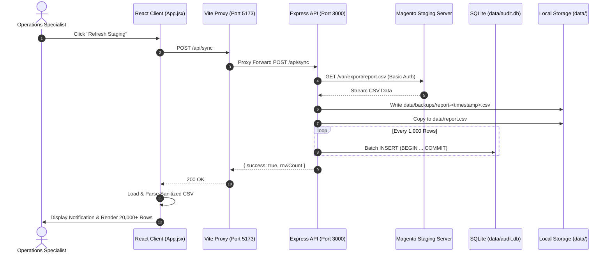
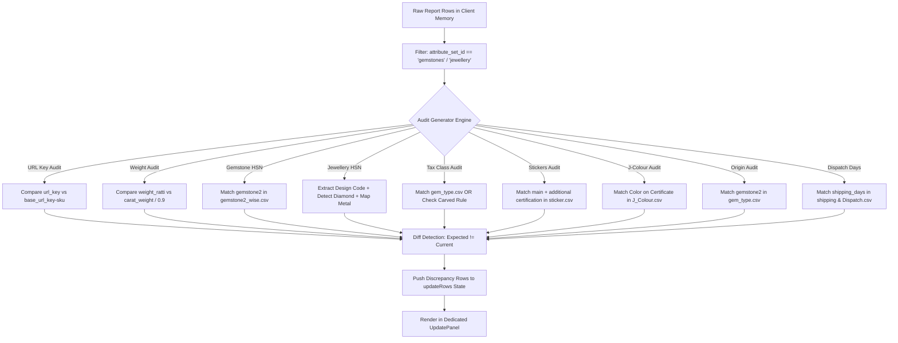
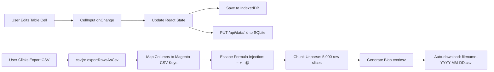

# Architecture & System Design Document (ARCHITECTURE.md)

## GemPundit Attribute & Catalog Audit Tool
**Document Version:** 1.0.0  
**Stack:** React 19 + Vite 8 + Tailwind CSS v4 + Express 5 + SQLite 3 + Python 3  
**Target Platform:** Node.js 20+ / Windows / Modern Chromium Browsers  

---

## 1. System Topology & Overview

The GemPundit Attribute Audit Tool operates as a hybrid architecture:
1. **Frontend Single Page Application (SPA):** Built with React 19 and Vite 8, utilizing Web Workers for multithreaded client-side filtering and sorting of tens of thousands of catalog records.
2. **Dual-Tier Server Layer:**
   - **Vite Dev Server Plugin / Middleware:** Provides transparent dev-time mock/proxy routes, CSV unparsing, reference database caching (`data/audit-databases-cache.json`), and credential isolation.
   - **Express Microservice (`server/index.js`):** Powers direct SQLite ingestion with transaction batching, backup archiving, and indexed search/filter queries over HTTP.
3. **Local Embedded Persistence:**
   - **SQLite (`data/audit.db`):** Server-side relational backing store for report records with parameterized CRUD operations.
   - **IndexedDB (`idb-keyval`):** Client-side non-volatile storage for active session state, custom options, and in-progress audit tables.
   - **Filesystem Snapshots (`data/backups/` & `data/report.csv`):** Point-in-time CSV backups for operational rollback and offline readiness.
4. **ETL Preprocessing Pipeline:**
   - Python scripts (`process_images.py`, `process_videodata.py`) for transforming Magento product media tables into denormalized catalog reference matrices.

```
+---------------------------------------------------------------------------------------+
|                               MAGENTO STAGING SERVERS                                 |
|  - report.csv (Catalog Export)           - skubyidexport.csv & q3.csv (Image Maps)    |
|  - videodata.csv (Video Assets)          - https://staging.gempundit.com/var/export/  |
+---------------------------------------------------------------------------------------+
                                        │ (Basic Auth Stream)
                                        ▼
+---------------------------------------------------------------------------------------+
|                             LOCAL BACKEND INFRASTRUCTURE                              |
|                                                                                       |
|   +─────────────────────────────────────+   +─────────────────────────────────────+   |
|   |         Express App (Port 3000)     |   |         Vite Dev Server (Port 5173) |   |
|   |  - /api/sync (Stream & Ingest)      |   |  - Proxy to port 3000 (/api/sync)   |   |
|   |  - /api/data (Paged SQLite Read)    |   |  - /api/audit/databases.json        |   |
|   |  - /api/data/:id (Single Cell Save) |   |  - Watcher Ignore Config            |   |
|   +─────────────────────────────────────+   +─────────────────────────────────────+   |
|                      │                                          │                     |
|                      ▼                                          ▼                     |
|   +─────────────────────────────────────+   +─────────────────────────────────────+   |
|   |    SQLite Database (data/audit.db)  |   |     Reference DBs (Database/*.csv)  |   |
|   |  - reports (60+ indexed attributes) |   |  - 12 ground-truth CSV lookup files |   |
|   |  - Backup snapshots (data/backups/) |   |  - Cached in audit-databases.json   |   |
|   +─────────────────────────────────────+   +─────────────────────────────────────+   |
+---------------------------------------------------------------------------------------+
                                        │
                                        ▼ (JSON REST / Memory Transfer)
+---------------------------------------------------------------------------------------+
|                                REACT 19 CLIENT APP                                    |
|                                                                                       |
|   +───────────────────────────────────────────────────────────────────────────────+   |
|   |                                  App.jsx                                      |   |
|   |   - Central Navigation & Active Tab Router (18+ Audit & Update Views)          |   |
|   |   - Master State: reportRows, databaseSheets, updateRows, stockRows           |   |
|   |   - IDB & LocalStorage Sync Layer                                             |   |
|   +───────────────────────────────────────────────────────────────────────────────+   |
|              │                                                │                       |
|              ▼                                                ▼                       |
|   +───────────────────────────────+               +───────────────────────────────+   |
|   |    UI Component Hierarchy     |               |    Audit Engine & Workers     |   |
|   |  - ReportTable.jsx            |               |  - auditGenerators.js         |   |
|   |  - UpdatePanel.jsx            |  <──────────> |    (14 pure audit rules)      |   |
|   |  - StockPanel.jsx             |               |  - auditWorker.js             |   |
|   |  - DatabaseTable.jsx          |               |    (Web Worker Filter & Sort) |   |
|   |  - VideoAuditPanel.jsx        |               |  - csv.js (Chunked Exporter)  |   |
|   |  - CellInput.jsx              |               +───────────────────────────────+   |
|   +───────────────────────────────+                                                   |
+---------------------------------------------------------------------------------------+
```

---

## 2. Component Architecture (Frontend)

### 2.1 State Management & Data Flow
- **Single Source of Truth:** `App.jsx` maintains `reportRows`, `updateRows` (keyed by panel ID), `stockRows`, and `databaseSheets`.
- **Row Lifting Pattern:** Instead of keeping modifications isolated to child table components, all edits are lifted to `App.jsx` and propagated to `IndexedDB` and server-side SQLite. When switching between "Export Data", "URL Key Audit", and "Price Update", table modifications are preserved.
- **Enrichment on Ingestion:** `enrichReportRow()` injects derived attributes immediately upon loading:
  - Parses jewellery SKUs to extract normalized `design_code`.
  - Normalizes numeric representations (e.g., stripping floating `.0` from `qty` and `price`).
  - Assigns unique client UUIDs (`createRowId()`) for DOM keying and row tracking.

### 2.2 Client-Side Multithreading (`auditWorker.js`)
When handling 25,000+ records with 60 columns each, in-thread searching and sorting causes significant frame drops.
- **Worker Initialization:** On mount, `ReportTable.jsx` spins up an inline Web Worker (`auditWorker.js`).
- **Initial Data Transfer:** Upon report ingestion, the raw row array is transferred to the worker memory via `INIT_DATA`.
- **Query Execution:** As user types in the search bar (debounced by 250ms) or alters multi-select filters, an event message `FILTER_SORT` is dispatched with parameters: `{ columns, search, attributeSet, statusFilter, stockFilter, sort }`.
- **Zero-Block Rendering:** The UI remains interactive at 60 FPS while the worker computes the filtered subset and posts back `FILTERED_ROWS`.

### 2.3 UI Component Breakdown

```
[App]
 │
 ├── [Sidebar]
 │    ├── Group: OVERVIEW (Export Data, Image DB, Video DB, Custom Options)
 │    ├── Group: ATTRIBUTE AUDIT (Url Key, Name, Classification, Gemstone HSN, ...)
 │    └── Group: UPDATE ATTRIBUTE (Price Update, Weight Update, In/Out Stock)
 │
 ├── [TopBar]
 │    ├── Brand Logo & Title
 │    ├── Progress Bar (Fetching / Processing indicators)
 │    ├── Staging Refresh Button
 │    ├── Save Cache Button
 │    └── Dark / Light Mode Toggle
 │
 └── [Active Panel Workspace]
      ├── [ReportTable] ──> Virtualized Grid + Worker Search + Column Filter
      ├── [UpdatePanel] ──> Audit Table + CellInput + Direct CSV Export
      ├── [StockPanel]  ──> Inverted Stock Filter + Inventory Action Formatter
      ├── [DatabaseTable] ──> Generic Viewer for Database/*.csv Reference Sheets
      └── [VideoAuditPanel] ──> Batch HTTP URL Health Checker & CDN Validator
```

---

## 3. Backend & Server Architecture

### 3.1 Dual-Server Strategy
The system supports two complementary execution models:
1. **Lightweight Dev Mode (`npm run dev`):** Runs Vite with internal configureServer hooks for `/api/audit/databases.json`, local caching, and proxy forwarding.
2. **Full Production Mode (`npm run start:all`):** Runs Vite dev server alongside the dedicated Express server (`node server/index.js`) via `concurrently`.

### 3.2 Express Server (`server/index.js`)
- **Port:** `3000` (proxied by Vite at `/api/sync` and `/api/data`).
- **Database Connection (`server/db.js`):** Singleton access to SQLite database located at `data/audit.db`.
- **Sync Endpoint (`POST /api/sync`):**
  1. Reads `GEMPUNDIT_REPORT_USERNAME` and `GEMPUNDIT_REPORT_PASSWORD` from `.env.local`.
  2. Initiates Axios stream GET request to `https://staging.gempundit.com/var/export/report.csv`.
  3. Pipes stream to a dated file in `data/backups/report-<timestamp>.csv` and copies to `data/report.csv`.
  4. Pipes backup CSV into `csv-parser` stream.
  5. Clears previous records (`DELETE FROM reports`).
  6. Executes parameterized batch inserts (`BATCH_SIZE = 1000`) within SQLite transactions (`BEGIN TRANSACTION` ... `COMMIT`).
- **Data Query Endpoint (`GET /api/data`):**
  - Accepts `page`, `pageSize`, `search`, `sort`, `direction`.
  - Performs SQL `LIKE` filtering against `sku`, `name`, `url_key`.
  - Safely sanitizes sort columns against `ALLOWED_COLUMNS` whitelist.
  - Returns `{ rows, total }`.
- **Cell Update Endpoint (`PUT /api/data/:id`):**
  - Accepts `{ field, value }`.
  - Validates `field` against `ALLOWED_COLUMNS` whitelist.
  - Executes `UPDATE reports SET <field> = ? WHERE id = ? OR sku = ?`.

---

## 4. Ground-Truth Reference Databases (`Database/*.csv`)

The application loads ground truth rules from twelve structured CSV files in the `Database/` directory. On startup, Vite parses these files and caches them in `data/audit-databases-cache.json`:

| File Name | Primary Keys | Core Attributes | Audit Usage |
|---|---|---|---|
| `gemstone2_wise.csv` | `gemstone2` | `url_key`, `hsn_code`, `hsn`, `shape` | Base URL Key lookup, Gemstone HSN codes |
| `hsn metal gemstone.csv` | `gemstone`, `metal_one`, `metal_two` | `hsn_code` | 8-digit HSN mapping for Jewellery items |
| `gem_type.csv` | `gemstone2` | `tax_class_id`, `classification`, `origin` | Tax classes, Precious/Semi-Precious, Origins |
| `sticker.csv` | `certification` | `stickers` | Certification to sticker tag mapping |
| `J_Colour.csv` | `colour` | `j_colour` | Resolves certificate color to standard J-Colour |
| `shipping & Dispatch.csv`| `shipping_days` | `dispatch_days` | Standard customer delivery timeline text |
| `Special Colour.csv` | `colour` | `special_tag` | Flagging rare/vivid color grades |
| `Vivid in Colour.csv` | `gemstone2`, `colour` | `is_vivid` | High-value saturation verification |
| `astro_non astro.csv` | `gemstone2` | `astrological_status` | Astrological gemstone qualification |
| `naming.csv` | `gemstone2` | `canonical_name` | Product title standardization |
| `specific_gravity.csv` | `gemstone2` | `min_sg`, `max_sg` | Lab test verification boundaries |
| `Custom Option Data.csv`| `sku`, `option_id` | `title`, `price`, `type` | Magento custom option pricing matrix |

---

## 5. Data Flow Diagrams

### 5.1 Ingestion & Synchronization Flow



### 5.2 Attribute Audit Calculation Flow



### 5.3 Edit & Export Pipeline



---

## 6. Security & Concurrency Considerations

1. **Staging Credentials Protection:**
   - Staging HTTP Basic Auth credentials (`GEMPUNDIT_REPORT_USERNAME`, `GEMPUNDIT_REPORT_PASSWORD`) are loaded strictly in server-side processes from `.env.local` or process environment.
   - Vite environment variables prefixed with `VITE_` are audited and stripped of sensitive keys.
2. **CSV Formula Injection Mitigation:**
   - Any cell value beginning with dangerous characters (`=`, `+`, `-`, `@`) is escaped in `escapeCsvCell()` by prepending a single quote `'` prior to unparsing.
3. **Database Injection Protection:**
   - All SQLite queries use parameterized queries (`?`) for both searches and field updates.
   - Column names in dynamic updates and sorts are strictly validated against `ALLOWED_COLUMNS` whitelist Set.
4. **Memory Crash Prevention:**
   - CSV parsing and downloading is chunked in batches of 5,000 rows.
   - Rows disabled in Magento are pruned at ingestion time to save 30-40% client memory.
